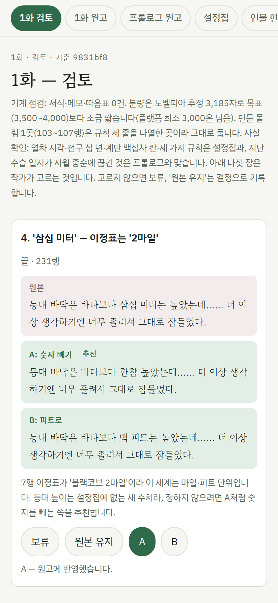

# StoryForge

### 웹소설이 길어져도, 앞에서 정한 이야기를 잊지 않도록

**StoryForge는 장편 웹소설의 설정을 기억하고, 새 원고에서 앞뒤가 맞지 않는 부분을 찾아주는 집필 보조 도구입니다.**

제가 직접 웹소설을 연재하면서 필요해서 만들었습니다. AI가 소설을 대신 쓰는 서비스가 아니라, **작가가 쓴 원고를 확인하고 수정할 부분을 제안하는 도구**에 가깝습니다. 무엇을 고칠지는 언제나 작가가 결정합니다.

**개발** 1인 개발 · **기간** 2026.10 ~ 진행 중 · **기술** Python, Claude Code, Codex CLI, Git, pytest

**45화의 실제 연재 원고에 적용 중** · 설정 검색부터 오류 검토, 모바일 수정 선택까지 연결

---

## 왜 만들었나요?

장편 소설은 수십 화만 지나도 기억해야 할 내용이 많아집니다. 인물의 관계, 이미 밝혀진 비밀, 세계관의 규칙처럼 작은 설정 하나가 뒤의 이야기와 충돌할 수 있습니다.

예를 들어 **앞에서 이미 비밀을 알게 된 인물이 수십 화 뒤에 처음 듣는 것처럼 반응한다면**, 작가는 이전 원고를 다시 뒤져야 합니다.

AI에게 검토를 맡겨도 문제가 있었습니다. 실제로 없는 대사를 근거로 오류를 지적하거나, 요청하지 않은 설정을 새로 넣기도 했습니다.

그래서 단순히 'AI에게 검토해 달라'고 요청하는 대신, **이전 원고를 찾아보고, 지적한 내용의 근거까지 확인하는 과정**을 만들었습니다.

## 어떻게 사용하나요?

```text
① 새 회차 원고 작성
         ↓
② 이전 이야기에서 관련 설정 찾기
         ↓
③ 설정 충돌·어색한 문장 검토
         ↓
④ 휴대폰에서 수정 제안 확인 → 작가가 직접 선택
         ↓
⑤ 확정한 내용을 다음 회차를 위한 기억에 반영
```

복잡한 설정을 직접 검색할 필요 없이 원고를 검토하고, 수정할 부분은 카드 형태로 받아볼 수 있도록 구성했습니다.

## 핵심 기능 3가지

### 1. 앞에서 쓴 이야기를 찾아줍니다

인물의 이름이나 별칭을 기준으로 **기존 설정, 인물 관계, 복선, 이전 대사**를 찾아 새 회차를 쓸 때 참고할 수 있게 합니다.

중요한 점은 AI의 요약을 무조건 믿지 않는다는 것입니다. **작가가 확정한 원고를 기준**으로 하고, 정해진 사실과 아직 구상 중인 아이디어도 구분합니다.

### 2. 오류를 찾아도, 근거부터 확인합니다

AI가 '이 장면은 앞의 설정과 맞지 않는다'고 판단하면 **실제 몇 화의 어떤 문장을 근거로 삼았는지** 확인합니다. 원고에 없는 인용은 검토 결과에서 제외합니다.

설정이 잘못됐다고 단정하기 어려운 경우에는 작가에게 확인할 항목으로 따로 표시합니다. 문장 길이, 반복 표현, 대사 기호 같은 항목도 함께 점검합니다.

### 3. 수정할지는 작가가 선택합니다

검토 결과는 원고를 통째로 바꾸지 않고 **문제 하나당 카드 하나**로 보여줍니다.

카드에서 원문과 수정안 A/B를 비교하고, 수정하거나 원본을 유지할 수 있습니다. 휴대폰에서 확인할 수 있도록 화면을 만들었습니다.

**화면 예시** (데모 작품을 사용한 화면)

<table>
<tr>
<td width="33%"></td>
<td width="33%"></td>
<td width="33%"></td>
</tr>
</table>

*왼쪽부터 오류를 발견하면 보여주는 검토 카드, 수정안을 선택하는 화면, 원고를 읽는 화면.*

## 실제로 어떤 문제를 잡았나요?

데모용 소설 1화를 검토했을 때 **총 5개의 수정 제안**이 나왔습니다. 장면의 순서, 어색한 표현, 주어와 서술어가 맞지 않는 문장, 시제 문제 등이었습니다.

그중 하나는 **거리 단위가 달라진 문제**였습니다.

> 기존 원고에서는 거리 단위로 '마일·피트'를 쓰고 있었는데, 새 문장에는 '삼십 미터'가 등장했습니다.
>
> StoryForge는 이 차이를 수정 카드로 보여주고, 수치를 빼는 방안을 제안했습니다. 최종 수정 여부는 작가가 선택합니다.

단순한 맞춤법 검사보다 **이 작품에서 이미 정한 내용과 새 원고가 일치하는지** 확인하는 데 초점을 맞췄습니다.

## 실제 운영 현황

**2026년 11월 기준**, 직접 연재하는 작품에 적용하며 계속 개선하고 있습니다.

| 확인할 수 있는 결과 | 내용 |
|---|---|
| 실제 원고에 적용 | **45화 확정·관리** (프롤로그 포함) |
| 다음 회차 검토 사례 | **56개 사실 확인 → 수정 제안 카드 6개** (46화 검토) |
| 구현 및 테스트 | **Python 도구 10종 · 자동 테스트 64개** |
| 다른 작품에도 적용 | **두 번째 작품 등록·운영** |

테스트용 예제만 만든 것이 아니라 **실제 집필 중 불편했던 점을 고치면서 사용해 온 도구**라는 것이 이 프로젝트의 특징입니다.

## 만들면서 가장 크게 바뀐 생각

처음에는 웹에서 AI가 소설을 자동으로 써주는 서비스를 구상했습니다. 하지만 직접 써보니 필요한 것은 자동 집필 기능보다 **이전 이야기를 잊지 않는 것, 그리고 AI의 검토를 믿을 수 있는 것**이었습니다.

그래서 웹 앱 개발을 보류하고, 원고 파일과 기존 작업 환경에서 바로 쓸 수 있는 도구로 방향을 바꿨습니다. AI에게 모든 판단을 맡기는 대신, **사실을 찾아주는 일과 문장을 이해하는 일, 수정 여부를 결정하는 일**을 분리했습니다.

---

<details>
<summary><strong>기술 구현과 설계 과정 자세히 보기 (개발자용)</strong></summary>

### 프로젝트 구조

- **Python 3.11 기반 CLI 도구:** 원고 검사, 기억 조회, 인용 검증, 모바일 검토 페이지 생성 등 10종
- **Claude Code 스킬 4종:** 집필 작업 흐름에 필요한 단계별 실행
- **Codex CLI:** 집필 맥락과 분리한 독립적인 사실 확인
- **Markdown + JSON + Git:** 원고 및 설정 관리, 이력 추적, 인물·사물 별칭 색인
- **pytest:** 자동 테스트 64개

초기 v2는 FastAPI + React 웹 앱을 구상했지만, 실제 사용 패턴에 맞춰 v3에서 로컬 CLI와 스킬 중심으로 전환했습니다. 핵심 로직은 `tools/`에 분리해 향후 웹 앱에서 재사용할 수 있도록 했습니다.

### 1. 장기 기억 관리

확정 원고를 정본으로 두고, 세계관 설정집·인물 문서·회차 기록·복선표·시간선을 따로 관리합니다. 같은 사실을 여러 곳에서 수정하며 서로 어긋나는 문제를 줄이기 위해 **한 사실은 한 담당 문서에만 기록**합니다.

- `recall`: 이름·별칭 색인(`entities.json`)을 통해 새 회차에 등장하는 인물과 관련된 설정, 복선, 원고 인용 검색
- `memory_audit`: 기억 문서에 인용한 문장이 확정 원고에 실제로 있는지 및 회차 번호 검증
- 상태 태그: `[원고 확정: N화]`, `[설정 확정]`, `[기획]`, `[후보]`, `[미정]`, `[인물의 추측]` 구분
- 세션 인계: `HANDOFF.md`, `작업_로그.md`, `codex/작업노트.md`와 자동 생성 `AGENTS.md`

인물의 과거 행적은 남기되, '현재 무엇을 알고 있는가'처럼 시점에 따라 바뀌는 정보는 최신 상태로 갱신합니다. 기억 점검은 읽기 전용으로 수행하고, 변경할 내용은 작가가 판단합니다.

### 2. AI 검토와 기계 검증 분리

Claude가 장면과 문체를 검토하고, Codex는 별도의 실행에서 원고의 사실 주장을 이전 회차와 비교합니다. Codex가 제시하는 근거는 `N화 L줄 「원문」` 형태로 제한하고, `codex_worker`가 해당 인용의 실제 존재 여부를 문자열로 검증합니다.

**검토자의 의견과 검토 근거를 구분**한 것입니다. 원문에 없는 인용은 제외하며, 기존 원고에서 찾을 수 없는 새 설정은 무조건 오류라고 단정하지 않고 `[작가 확인]` 항목으로 분리합니다.

숫자 계산, 대사 기호의 짝, 인용문 일치처럼 답이 정해진 항목은 코드로 처리하고, 연속성과 문체처럼 해석이 필요한 항목은 AI 검토에 남겼습니다.

### 3. 문체 점검과 모바일 편집 안전장치

`check_episode`는 분량, 서식, 대사 기호, 단문이 몰리는 구간, 반복 표현을 검사합니다. 공통 문체 패턴 15종과 작품별 규칙을 사용하되, 패턴이 감지됐다는 이유만으로 자동 수정하지는 않습니다.

`mobile_page`는 원고·검토 카드 탭이 있는 Claude Artifact 페이지를 만듭니다. 수정 카드는 `{find, repl}` 형태의 치환 정보를 가지며, 대상 문단이 원고에 정확히 한 번 존재하는지 검사합니다.

모바일에서 이전 버전의 원고를 다시 저장하면 수정이 되돌아갈 수 있어 `guard`로 되돌림을 확인합니다. Windows 원고의 CRLF 줄바꿈이 변경된 경험 이후에는 원고 치환 과정과 줄바꿈 형식도 점검하도록 했습니다.

### 점검 기록과 한계

| 점검 대상 | 결과 |
|---|---|
| 기억 문서 전체 인용 | **3,429 / 4,101개** 원문 일치 (약 83.6%) |
| 구조 개편 후 작성한 인물 문서 인용 | **974 / 980개** 원문 일치 (약 99.4%) |
| 46화 사실 확인 | 주장 56개 검토, 제출한 근거 인용 42개 원문 일치, 수정 카드 6개 |
| 개발 규모 | Python 약 3,300줄, 저장소 커밋 1,300회 이상 |

전체 인용 일치율이 낮은 주된 이유는 초기 문서에 원문을 바꿔 쓴 요약을 따옴표 안에 넣은 경우가 있었기 때문입니다. 개편 후 인물 문서의 수치는 별도 집합을 대상으로 한 결과로, 동일 조건의 전후 비교 실험은 아닙니다. 46화의 인용 42개가 모두 맞았다는 수치 역시 **해당 실행에서 제출한 인용의 검증 결과**이지 모든 오류를 잡았다는 뜻은 아닙니다.

### 앞으로 개선할 부분

- 초기 기억 문서의 부정확한 인용을 정리하고 원문 일치율 개선
- 200화 이상을 대비한 장별 기억 압축과 복선 관리
- Claude와 Codex가 놓친 오류를 독립적으로 비교해 검토 성능 측정
- 작가가 퇴고한 문장 차이에서 문체 패턴을 추출하는 기능
- 이름·별칭 검색으로 찾기 어려운 장면을 위한 원고 전문 검색

</details>
