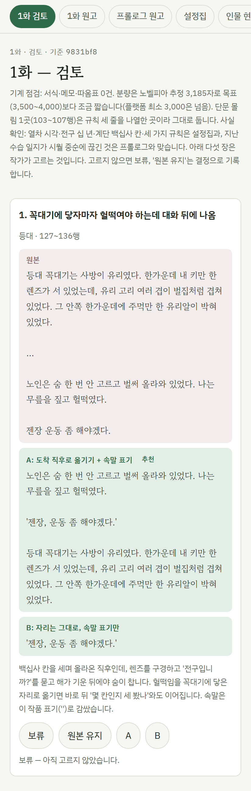
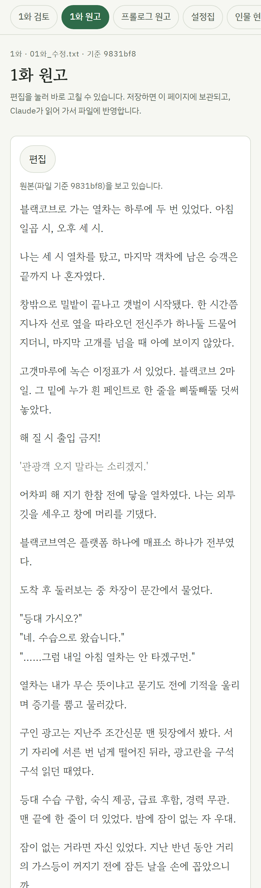

# StoryForge

**장편 웹소설의 설정과 문체를 관리하는 CLI 기반 집필 보조 도구**

> **개발 형태** 1인 개발  
> **기술** Python 3.11, Claude Code, Codex CLI, pytest, Git

StoryForge는 제가 직접 연재하는 웹소설을 관리하기 위해 만든 도구입니다.

회차가 쌓일수록 앞에서 정한 설정을 찾기 어려워지고, AI에게 검토를 맡기면 존재하지 않는 대사를 근거로 들거나 원고를 멋대로 고치는 일이 생겼습니다. 이 문제를 해결하려고 **기억 검색, 원문 대조, 문체 점검, 수정 제안**을 하나의 작업 흐름으로 묶었습니다.

목표는 AI가 소설을 대신 쓰는 것이 아닙니다. **작가는 원고와 설정을 결정하고, AI는 필요한 정보를 찾아 검토하는 역할**에 집중하도록 설계했습니다.

## 프로젝트 한눈에 보기

| 구분 | 내용 |
|---|---|
| 사용 환경 | 실제 연재 원고 45화 확정·관리(프롤로그 포함, 2026.11 기준) |
| 구현 범위 | Python CLI 도구 10종, Claude Code 스킬 4종, 테스트 64개 |
| 핵심 기능 | 장기 기억 검색, 설정 충돌 검토, 원문 인용 검증, 문체 점검, 모바일 수정 카드 |
| 운영 방식 | 원고·기억 문서는 Git으로 관리하고, Claude와 Codex가 서로 다른 단계에서 검토 |

## 왜 만들었나

처음에는 장편 연재를 AI로 보조하면 집필 속도가 빨라질 거라고 생각했습니다. 하지만 30화 안팎부터 더 큰 문제가 드러났습니다.

- 앞에서 정한 **인물의 나이, 호칭, 관계, 비밀을 아는 사람**이 이후 회차에서 달라졌습니다.
- AI가 **원문에 없는 대사**를 인용하며 설정 오류라고 주장했습니다.
- 검토나 문장 제안을 요청했을 뿐인데 **새로운 규칙이나 수치가 확정 설정처럼 추가**되기도 했습니다.
- 문장 리듬을 다듬는 과정에서 **짧은 단문, 반복 대사, 번역체 표현**이 늘어났습니다.

결국 필요한 것은 자동 집필 기능보다 **기존 원고를 정확히 기억하고, 검토 결과를 믿을 수 있게 만드는 장치**였습니다.

### 웹 앱에서 CLI로 방향을 바꾼 이유

초기 v2는 FastAPI와 React로 구성한 자동 집필 웹 앱을 구상했습니다. 실제로 원고를 쓰고 검토해 보니 웹 화면보다 원고 파일과 기억 문서를 직접 다루는 작업이 훨씬 많았습니다.

그래서 v3에서는 Claude Code가 Python 스크립트와 스킬을 실행하는 **CLI 중심 구조**로 바꿨습니다.

- 별도 서버 없이 로컬 파일과 Git을 그대로 활용할 수 있습니다.
- 벡터 DB 대신 Markdown 문서와 이름·별칭 색인을 사용해 검색 결과를 추적하고 수정하기 쉽게 했습니다.
- 웹 앱은 다중 사용자나 비용 관리가 필요한 시점으로 미뤘습니다. 핵심 로직은 `tools/`에 분리해 두었습니다.

## 어떻게 동작하나

전체 흐름은 **집필 전 기억 조회 → 원고 점검 → 독립 검토 → 작가 승인 → 기억 갱신**으로 이어집니다.

```text
[확정 원고] ──→ [설정·인물·회차·복선 문서] ──→ [이름/별칭 색인]
     ▲                                            │
     │                                          recall
     │                                            ▼
[작가가 확정] ←── [수정 카드] ←── [원고 검토] ←── [새 회차 초안]
                     ▲                  │
                     │           check_episode (기계 점검)
                     │           Claude (문맥·문체 검토)
                     └────────── Codex + codex_worker
                                 (독립 사실 확인·원문 인용 대조)
```

아래는 이 과정에서 중점적으로 구현한 기능입니다.

### 1. 원고를 기준으로 장기 기억 관리

AI의 요약을 그대로 사실로 취급하면 요약 과정의 실수까지 다음 회차에 이어집니다. 그래서 **확정 원고를 유일한 기준**으로 두고, 기억 문서는 원고를 다시 찾기 위한 자료로 사용합니다.

기억은 설정집, 설정 대장, 회차 기록, 복선표, 시간선, 인물 현황, 인물 개인 문서로 나눴습니다. 같은 사실이 여러 문서에서 서로 다르게 갱신되지 않도록 **한 사실은 한 담당 문서에만 기록**하고, 다른 곳에서는 참조만 하게 했습니다.

특히 `인물 현황`은 과거 기록을 계속 덧붙이는 대신 현재 상태로 갱신합니다. 예를 들어 12화에는 몰랐지만 30화에 알게 된 비밀을 두 문장으로 병치하면 AI가 어느 상태를 따라야 하는지 혼동하기 때문입니다. 과거 변화는 회차 기록과 인물 개인 문서에서 확인합니다.

**구현한 장치**

- **상태 태그:** `[원고 확정: N화]`, `[설정 확정]`, `[기획]`, `[후보]`, `[미정]`, `[인물의 추측]`으로 기록을 구분합니다. 인물이 말한 추측을 세계관의 사실로 승격시키지 않기 위해서입니다.
- **`recall`:** `entities.json`의 인물·사물 이름과 별칭을 이용해 관련 설정, 복선, 원고 인용을 모읍니다. 새 초안에서 등장 대상을 찾고 직전 회차 마지막 장면도 함께 제공합니다.
- **`memory_audit`:** 기억 문서의 인용이 실제 확정 원고에 있는지, 회차가 맞는지 자동으로 확인합니다. 공백·문장부호 차이와 생략 부호로 나뉜 인용도 처리합니다.
- **세션 인계:** `HANDOFF.md`, `작업_로그.md`, `codex/작업노트.md`에 진행 상황과 이전에 기각한 제안을 남겨 세션이 바뀌어도 이어갈 수 있게 했습니다. Codex용 `AGENTS.md`는 크기 한도 내에서 생성합니다.

회차 확정 시에는 기억 문서를 갱신하고 `memory_audit`을 실행합니다. 장이 끝날 때는 `memory-dream` 스킬로 오래된 인물 상태나 빠진 복선 진행 상황을 다시 점검합니다. **점검 결과는 수정 제안으로만 남기고 자동 반영하지 않습니다.**

### 2. AI의 검토 결과도 다시 검증

AI가 '몇 화에 이런 대사가 나온다'고 자신 있게 설명해도 원문에는 없는 경우가 있었습니다. 이런 지적을 다시 AI에게 검토시키는 것만으로는 충분하지 않았습니다.

그래서 **해석이 필요한 작업과 기계적으로 판정할 수 있는 작업을 분리**했습니다.

1. **Claude**가 장면 흐름, 문체, 설정 충돌 가능성을 검토합니다.
2. **Codex**는 집필 맥락을 이어받지 않은 별도 실행에서 사실 주장을 뽑고, 앞 회차 원문을 확인합니다.
3. Codex는 `근거: N화 L줄 「원문」` 형식으로 근거를 제출합니다.
4. **`codex_worker`**가 인용 문장이 실제 원고에 있는지 대조합니다. 근거가 맞지 않는 지적은 버리고, 일치한 지적도 Claude가 다시 확인한 뒤 카드로 올립니다.

이때 확인하는 것은 기존 설정과의 충돌만이 아닙니다. **완성 원고에서 사실처럼 쓰인 문장**을 거꾸로 추적해, 작가가 정한 적 없는 기간·수치·마법 규칙 등이 들어왔는지도 찾습니다. 기존 원고에서 근거를 찾지 못한 내용은 오류로 단정하지 않고 `[작가 확인]` 항목으로 분리합니다.

권한도 제한했습니다. Codex는 원고와 기억 문서를 읽을 수 있지만 `codex/` 작업 공간 외에는 쓰지 않습니다. 기억 문서 갱신은 Claude가 담당하고, 원고의 내용 수정은 작가가 결정합니다.

### 3. 문체는 자동 점검하되, 판정은 사람에게

문체를 LLM의 감상에만 맡기면 같은 문장에도 판단이 흔들립니다. `check_episode`에는 **기계적으로 셀 수 있는 항목**을 넣었습니다.

- 대사 기호 짝, 분량, 서식 같은 기본 오류
- 서술문에서 짧은 문장이 연속되는 구간(대사 제외, 장면 전환 기준으로 구분)
- 번역체나 반복 표현을 포함한 공통 문체 패턴 15종과 작품별 추가 패턴
- 작품마다 조정할 수 있는 패턴 허용 횟수와 문단 호흡 기준

예를 들어 '그녀' 남용, 'A가 아니라 B'의 반복, 감정을 다시 설명하는 문장 등을 후보로 표시합니다. **패턴에 걸렸다고 무조건 잘못된 문장은 아닙니다.** 실제 작가가 퇴고한 회차를 기준으로 수치를 조정하고, 대사가 부자연스러운지 같은 판단은 검토 단계에 남겼습니다.

### 4. 모바일 검토 카드로 수정 권한 유지

집필은 PC에서 하지만 원고를 읽고 수정안을 고르는 일은 휴대폰에서도 합니다. 이를 위해 `mobile_page`가 **원고 탭과 검토 카드 탭**이 있는 Claude Artifact 페이지를 만듭니다.

카드 하나에는 문제 하나만 담습니다. **원문, 제안 A/B, 보류, 원본 유지**를 보여 주고, 작가가 선택한 문장만 원고에 반영하도록 했습니다. '원본 유지'를 선택하면 같은 제안을 계속 반복하지 않으며, 확인되지 않은 내용 변경도 자동 실행하지 않습니다.

문단 치환은 `{find, repl}` 형식으로 관리합니다. 수정할 문단이 원고에서 정확히 한 번 나오는지 검사한 후 치환합니다. 또 `guard`가 이전 수정이 오래된 저장본으로 되돌아갔는지 확인하고, 모바일 페이지 저장 시각과 PC 파일 수정 시각을 비교해 최신 버전을 판단합니다.

**실제 데모 화면** — `examples/demo_novel`의 1화를 검토해 만든 예시입니다.

<p align="center">
  
  
  
</p>

*왼쪽부터 검토 카드, 수정안 선택, 원고 편집 화면입니다.*

데모에서는 장면 순서, 번역체 표현, 주어·서술어 호응, 시제 등 **총 5건의 수정 카드**가 나왔습니다. 그중 하나는 원고에 등장한 '삼십 미터'가 기존 작품의 거리 단위(마일·피트)와 어긋나고 사전에 정하지 않은 수치라는 점을 짚어, 숫자를 제거하는 안을 제안한 사례입니다.

## 실제로 운영하며 확인한 것

<sub>2026년 11월 기준. 아래 수치는 테스트 전체에 대한 일반적인 정확도가 아니라 해당 시점의 운영 및 점검 기록입니다.</sub>

| 항목 | 결과 |
|---|---:|
| 실제 연재 원고 | **45화 확정**(프롤로그 포함) |
| 작품 저장소 이력 | **1,300회 이상 커밋** |
| 기억 문서 인용 대조 | **3,429 / 4,101개 일치**(83.6%) |
| 개편 후 작성한 인물 개인 문서 인용 | **974 / 980개 일치**(99.4%) |
| 46화 독립 사실 확인 사례 | **주장 56개 확인**, 근거 인용 42개 원문 일치, 수정 카드 6장 |
| 구현 규모 | Python 약 **3,300줄**, 도구 10종, 스킬 4종, 테스트 64개 |
| 재사용 | **두 번째 작품**도 같은 도구로 등록해 운영 |

전체 인용 일치율이 83.6%인 것은 초기 문서에 원문을 바꿔 쓴 요약이 인용문 형태로 남아 있기 때문입니다. 이후 '한 사실 한 문서' 원칙으로 새로 만든 인물 개인 문서는 99.4%가 일치했습니다. 다만 **서로 다른 문서 집합의 수치이므로 개선 효과를 동일 조건에서 비교한 실험 결과로 보지는 않습니다.**

또한 46화 사례에서 Codex가 제출한 근거 인용 42개가 모두 원문과 일치했다는 것은 **그 실행의 근거 대조 결과**입니다. 모델의 모든 설정 오류 탐지율이 100%라는 뜻은 아닙니다.

## 시행착오에서 바꾼 설계

### 기억을 많이 남기는 것보다, 현재 상태를 분명히 하는 것이 중요했다

초기에는 같은 정보를 회차 기록과 인물 문서에 반복해서 적었습니다. 문서가 늘어날수록 서로 다른 '현재 상태'가 생겼고, AI가 옛 내용을 다시 인용했습니다. 담당 문서를 나누고, 현재 상태는 덧붙이지 않고 갱신하는 방식으로 바꿨습니다.

### 검토자를 늘리는 것만으로는 환각이 사라지지 않았다

Codex도 없는 문장을 근거로 제시한 적이 있습니다. 이를 해결한 것은 또 다른 모델의 평가가 아니라 **원문과 인용문을 직접 대조하는 코드**였습니다. 이 경험 이후 개수 세기, 기호 짝 확인, 인용 검증 등은 LLM 대신 도구가 담당하게 했습니다.

### '도와주는 수정'도 원고를 망가뜨릴 수 있었다

작가 메모를 수정 지시로 잘못 해석하거나, 모바일에서 오래된 사본을 저장해 이미 고친 문장이 되돌아온 일이 있었습니다. 그래서 **내용 수정은 명시적 승인 후에만**, 이미 결정한 수정은 `guard`로 감시하도록 바꿨습니다.

Windows 원고의 CRLF 줄바꿈이 `sed -i` 실행 후 LF로 바뀐 적도 있습니다. 이후 원고 치환은 바이트 단위로 처리하고, 마지막 점검에서 줄바꿈 형식도 확인합니다.

## 다음에 개선할 부분

- **인용 정리:** 초기 기억 문서의 요약 문장을 실제 원문 인용 또는 인용 부호 없는 요약으로 정리
- **장기 연재 대비:** 200화 이상을 목표로 아크별 기억 압축과 회수된 복선 정리 방식 개선
- **검토 성능 측정:** Claude와 Codex를 같은 회차에 독립 적용해 실제 놓침 비율 비교
- **문체 기준 자동화:** 작가가 퇴고하면서 지운 표현을 diff로 수집하고, 작품별 문체 기준선 계산
- **검색 확장:** 이름·별칭 색인으로 찾기 어려운 장면이 늘어나면 전문 검색 도입 검토
